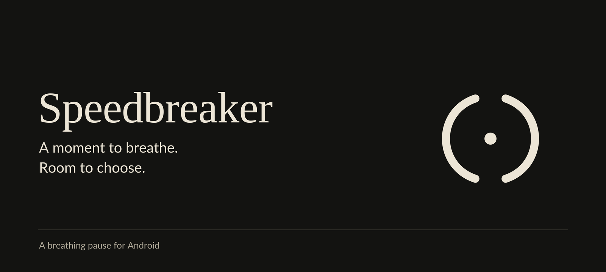
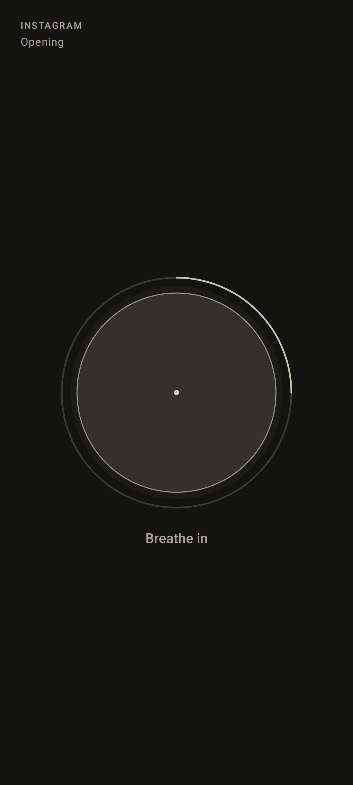
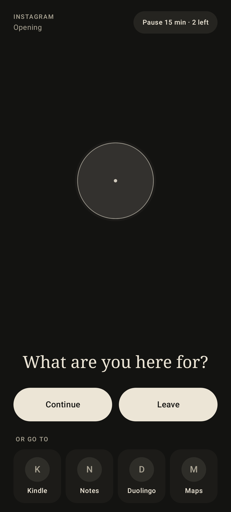
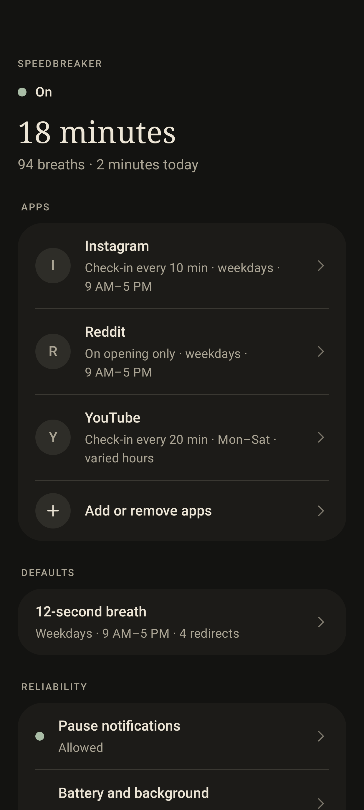

# Speedbreaker

**Make the next tap intentional.**

Speedbreaker adds a breathing pause before the Android apps you choose. Take a
moment, then continue, leave, or open somewhere else. Optional check-ins bring
that same pause back during continuous use.

[Get the APK](https://github.com/beejsbj/speedbreaker/releases) ·
[Setup guide](docs/getting-started.md) ·
[Privacy](docs/privacy.md) ·
[Report a bug](https://github.com/beejsbj/speedbreaker/issues/new/choose)

Android 8.0 or newer. Installed from an APK; not currently on Google Play,
F-Droid, or iOS.

Version **1.0.1** fixes incoming-call interruption, keeps active pause controls
available in the app, and protects saved settings during screen changes.
See the [release notes](https://github.com/beejsbj/speedbreaker/releases/tag/v1.0.1).

## A little room to choose

- **Choose your own apps.** Nothing is selected for you.
- **Take a breath.** Twelve seconds by default, adjustable from 8 to 60 seconds.
- **Decide what comes next.** Continue in the app, Leave for your home screen,
  or choose from up to four optional redirect apps, with their own icons.
- **Check in again.** By default, another breath follows ten minutes of
  continuous use. Change the interval or turn check-ins off for each app.
- **Set your hours.** Stay active all day or choose a weekly schedule, with
  separate schedules for individual apps when needed.

There are no streaks, usage scores, or daily screen-time budgets. Speedbreaker
works locally, without an account, ads, analytics, or cloud sync.

## A look inside

| Take a breath | Choose what comes next | Make it yours |
| --- | --- | --- |
|  |  |  |

Screens rendered from the app's UI with example settings. App icons appear as
monograms here; installed apps show their own icons on a phone. You choose your
own apps and redirects.

## Install and get started

1. Open [GitHub Releases](https://github.com/beejsbj/speedbreaker/releases) and
   download the `.apk` from a release's **Assets**, rather than a source archive.
2. Open it on your phone. If prompted, allow your browser or file manager to
   install this APK, then follow Android's installer.
3. Open Speedbreaker, read the Accessibility disclosure, and tap
   **I understand — continue**.
4. Tap **Turn on in Accessibility** and enable **Speedbreaker attention pauses**.
5. Return to Speedbreaker, tap **Allow call-state access**, and allow Phone
   permission. Breaths stay off without it so silent calls are not hidden.
6. Tap **Choose apps**. Open a chosen app to try it.

If Android says the Accessibility setting is restricted, open Speedbreaker's
**App info → ⋮ → Allow restricted settings**, confirm your identity, and return
to Accessibility. Menu names vary by phone. Keep Play Protect enabled.

Allow **Pause notifications** to use the fifteen-minute Pause option. On Samsung,
check **Reliability → Battery and background** for background-operation guidance.
See the [setup and troubleshooting guide](docs/getting-started.md) for details.

## Know how the pause behaves

**The first eight seconds intentionally hold the breathing screen.** Home, Back,
and Recents cannot dismiss it during that time. At eight seconds, Leave,
configured redirects, and Pause become available; Continue waits until the full
breath finishes. Ordinary navigation can leave after eight seconds.

Each chosen app gets two fifteen-minute pauses per local day. **Active pauses**
on the home screen and the pause notification both offer **End now**; the in-app
control remains available if the notification is dismissed. After Continue, returning within sixty
seconds resumes the session; a longer absence starts a new opening breath.
Visible apps in split-screen and picture-in-picture count toward check-ins.

The app yields to Android-reported calls, communication audio, the dialer, the
lock screen, screen-off, and Android Settings. Calling apps that do not report
their calls to Android may not be detected while ringing. One Hand Operation+ edge gestures are unavailable while
the overlay is visible; use Leave, a redirect, or ordinary navigation once
choices unlock. You can turn Speedbreaker off in Android Accessibility settings.

## Privacy and device support

Accessibility lets Speedbreaker identify visible apps and display its pause.
Phone permission supports a call-state check, without reading numbers, call
history, or audio. The app does not read message text, take screenshots, or store
usage history.
Settings and pause state stay on the phone. It requests no Internet, Usage
Access, or separate “display over other apps” permission. Android backup and
device transfer of app data are disabled in its configuration.
[Read the full privacy details](docs/privacy.md).

Version 1.0.1 was checked on a Samsung Galaxy S23+: opening pauses,
Phone permission setup, a silent incoming call during the initial lock, and
ending a pause after swiping away its notification, real redirect icons, and
opening the optional support link. Android API 35 emulator
checks also cover audible/silent calls, touching Answer, ordinary navigation,
and a fresh breath after the call ends. See the
[verification record](docs/reviews/2026-10-11-1.0.1.md) for precise scope.
Reboot/recovery, extended idle, and other manufacturers remain unverified.
Android 8.0 is the minimum supported OS, not a claim that every compatible
phone has been tested.

## Help improve Speedbreaker

If Speedbreaker helps, you can support its development. Support is optional;
every feature stays free.

Found something unexpected? [Report a bug](https://github.com/beejsbj/speedbreaker/issues/new/choose)
with your phone model, Android and app versions, steps, and what happened.
Please remove personal information from screenshots and logs. For a security
concern, follow [SECURITY.md](SECURITY.md).

- [Contributing](CONTRIBUTING.md) — useful reports and focused changes.
- [Build and test](docs/build-and-test.md) — local development setup.
- [Changelog](CHANGELOG.md) — what is in each version.
- [Interaction contract](docs/interaction-contract.md) — detailed behavior;
  includes historical development context.

## License

Speedbreaker is licensed under [Apache License 2.0](LICENSE). Third-party
components retain their own licenses and notices.

For current distribution and possible future store or platform availability,
see [Distribution](docs/distribution.md).
